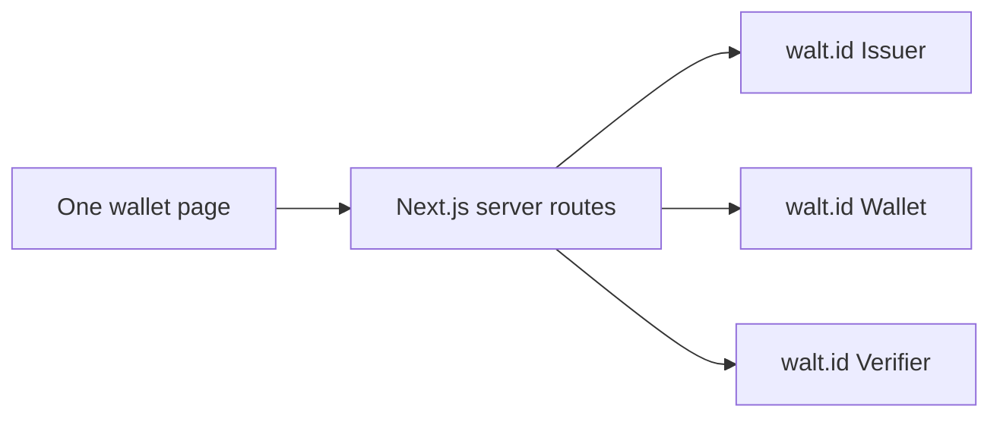

# Small wallet demo architecture

Updated: 2026-11-08. Direction revised after the owner's simplicity review. This is a demo app with walt.id supporting services. The current working F1 behavior and the [proved integration](../../pocs/README.md) are retained.

## Runtime target

| Component | Purpose |
|---|---|
| One Next.js app | Basic React wallet page and small server routes calling walt.id |
| walt.id Issuer2 | Issue the single fictional Training Certificate |
| walt.id Wallet2 | Store credentials/keys and perform the presentation |
| walt.id Verifier2 | Return the actual verification result |

Use one Compose project and one internal network for these four containers. Keep existing persistent wallet storage. The app may keep its existing small SQLite session-to-wallet lookup; it is an embedded file, not an additional database service. Add no separate backend, database server, queue, cache, identity provider, or admin app.

**Current implementation (2026-11-09):** all four services are defined in the root Compose project `diw-local`. The app uses `http://localhost:47831`; service ports remain loopback-only at 7004–7006. Migration retained `diw-walt_wallet-data`, `diw-local_coordination`, `diw-walt_default` and the existing signing configuration. Legacy `diw-walt` containers remain stopped for rollback; do not run them alongside the new services. No data volume was deleted or signing key rotated.

## UI and application code

Use one wallet page with participant tabs: Wallet (User) opens by default, Issuer explains Northstar Learning and creates the fixed sample offer, and Verifier contains Harbor Works request preparation. Tabs share the current visitor session; they are not accounts or separate portals. Keep acceptance and sharing-consent decisions in Wallet (User). Sharing approval is bound to the current request, selected credential and a digest of the signed credential, full claims and authorization request; any change requires fresh review. Only decision metadata/digests are persisted by the app. F7 builds and sends only that exact approved credential through Wallet2, records a single submission attempt and shows the actual correlated Verifier2 verdict. Proof tokens stay server-side; result checks do not resend. Read-only identity profiles show the current wallet/key references, credential-derived issuer DID/public key and holder public-key binding. The current holder has no DID; the verifier uses unsigned redirect_uri requests without a DID/signing key. Profiles never expose private key material or mutate identity configuration. Show offer review and sharing consent in small panels/dialogs, credential details inline, and the verification result on the same page. The user-facing journey is receive → view → approve sharing → see result. F1–F9 are implementation checkpoints, not nine separate pages or subsystems.

Keep walt.id calls in a small server client and write straightforward handlers for the current scenario. Add a helper only when there is actual shared behavior. Avoid generic repositories, plugin registries, workflow engines, configurable scenarios, and abstractions for hypothetical future services.

Reuse the working session ownership and provisioning checks. Do not extend them into a general recovery framework. Keep errors bounded and understandable, disable repeated submissions, and never turn an unknown operation into success. Any later simplification of the existing retry logic must preserve the documented behavior and be checked before replacing it; no destructive rewrite is authorized by this review.

## Safety that stays

- One isolated demo wallet per visitor session, identified by a protected cookie; ownership is checked on the server.
- Fictional data only. Service credentials and signing keys stay server-side; walt.id owns credential cryptography and storage.
- Review before receiving/sharing; cancel submits nothing; Verified comes from the real verifier result.
- Keep strict TypeScript, input validation, existing useful tests, and persistent wallet/key storage.
- Keep private research/runtime files out of public artifacts. Before publication, hide management APIs and apply basic expiry/resource limits.

These are the demo's safety boundaries, not a reason to add production-scale infrastructure.

## Decisions already proved

walt.id **1.2.1**, holder-bound **dc+sd-jwt**, ES256 and the fictional training scenario work end to end. Exact image digests, endpoints, verification checks, storage mounts and reproducible proof commands live in the [integration record](../../pocs/README.md). Do not repeat the integration experiment for every feature unless its dependencies change.

The current local development containers used about **1.06 GiB combined** in one idle snapshot. That is an observation, not a VPS sizing guarantee. Use the normal production app build when publishing; inspect the existing VPS later before changing it.

## Deployment later

**2026-11-09 owner-directed presentation deployment:** [Vercel](https://digital-identity-demo.vercel.app) now serves the UI and proxies `/api/*` through a temporary tunnel to the existing Docker app. Durable state stays on the Docker volumes. The exact public origin governs secure cookies and mutations. This requires the owner's machine, Docker and tunnel to remain running; it is not the VPS release gate below. F9 retires the current session atomically and creates a separate empty wallet on the next explicit start; old data is retained privately. See [deployment notes](../plan/vercel-demo.md) and [F9 evidence](../workitem/F9-reset-current-demo-verification.md).

Finish the basic walkthrough locally first. Then inspect the existing VPS, reuse its reverse proxy/HTTPS, and deploy the same small stack to one demo subdomain. Only required app/protocol routes become public. No Kubernetes, separate issuer/verifier portals, MPC, product backup/recovery, or portfolio landing page belongs in this build.

See the [PRD](../spec/prd.md) for behavior, the [short delivery plan](../plan/demo-plan.md) for order, and [local development](../plan/local-development.md) for today's actual commands.
